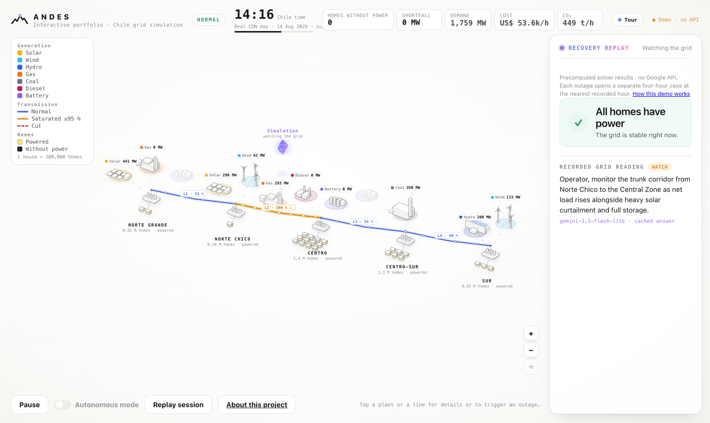
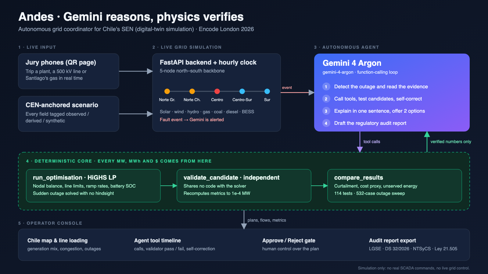

<div align="center">


# Andes

**Gemini reasons, physics verifies.**
An AI grid coordinator that helps Chile's power system recover from sudden outages, inside a verified digital-twin simulation.

🏆 **Winning project · Gemini × Google DeepMind hackathon · Encode London, 24–25 October 2026**

[**▶ Try the interactive demo**](https://aleetreny.github.io/Andes/) · [About the project](https://aleetreny.github.io/Andes/about) · [Design document](docs/hackathon-design.md)


[](https://github.com/aleetreny/Andes/actions/workflows/pages.yml)

</div>

[](https://aleetreny.github.io/Andes/)

---

## The case study

### The problem

Chile's national grid (SEN) runs more than 3,100 km from Arica to Chiloé along one long north–south backbone. Two problems collide on that line:

- **Congestion and curtailment.** The Atacama desert in the north produces huge amounts of cheap solar power, but most demand sits around Santiago and further south. When the transmission corridors fill up, clean energy is thrown away while thermal plants keep running elsewhere.
- **Sudden contingencies.** When a large plant or a 500 kV line trips, power flows shift instantly. If the remaining units can't ramp fast enough, automatic load shedding (EDAC) cuts off entire feeders, and hundreds of thousands of homes go dark until operators find a safe redispatch.

### Why now

Supreme Decree 32/2026 requires Chile's grid operator (CEN) to move to automated, security-constrained economic dispatch (SCED). CEN's August 2026 implementation plan shows how far there is to go. Some dispatch instructions are still sent by email. Only 43.4% of the 355 facilities in scope had passed signal-validation tests, and full SCED production is targeted for 2029.

### The idea: Gemini reasons, physics verifies

Language models are good at reading a messy situation, forming hypotheses and explaining trade-offs. They are not trustworthy calculators. Andes splits the work accordingly:

- **Gemini is the coordinator.** It watches the grid, detects the outage, decides which tools to call, tests candidate fixes, corrects itself when a plan fails, and explains the outcome in one plain sentence.
- **Deterministic code provides every number.** A HiGHS linear programme computes the dispatch, and a separate validator that shares no code with the solver recomputes every constraint. Gemini can only quote numbers that came back from these tools.
- **A human makes the call.** The operator sees two validated plans side by side and applies or vetoes one. An optional autonomous mode applies the recommended plan after a countdown, still inside the simulation.

### A crisis, step by step

1. **18:00, evening peak.** The 600 MW gas plant in central Chile trips without warning.
2. **No hindsight.** The solver locks every decision made before the fault. The surviving coal, hydro and gas units are already near full output, the diesel peaker maxes out, and ramp limits slow everything else down. Centro starts shedding load.
3. **Investigation.** Gemini reads the evidence and tests recovery options: a battery in the north, a battery in the south, or uprating the congested corridor. Each one goes through the solver and the validator.
4. **Decision.** Two validated plans reach the operator with their cost, unserved energy and homes reconnected. The chosen plan plays out on the map hour by hour, and Andes drafts an audit report modelled on CEN's operating-instruction log.

### Results on the demo scenario

| Question | Outcome (simulated) |
| --- | --- |
| Where should a 150 MW / 600 MWh battery go to cut midday curtailment? | In the north it saves **631.6 MWh** of solar. In the south it saves **0 MWh**, because it sits on the wrong side of the bottleneck. |
| How much does that battery help in the 18:00 gas outage? | **391.9 MWh** less unserved energy, and load shedding ends one hour sooner. |
| Does uprating the congested line help in the crisis? | No: **0 MWh**. The comparison tool exposes that, so Gemini can't claim otherwise. |
| Can the numbers be trusted? | **114** optimisation tests plus a **532-case** outage sweep that trips every asset, in planned and sudden mode, and checks every result independently. |

These figures come from the committed five-zone demo scenario. They are reproducible model outputs, not measured savings on Chile's real grid.

### Live at the hackathon

On stage, the jury became the attacker. Each judge scanned a QR code and could sabotage the grid from their phone by tripping a plant, cutting a 500 kV line or knocking out Santiago's gas supply. A FastAPI backend streamed every event to the big screen in real time. Gemini analysed the attack while the simulated clock paused, then presented two recovery plans for the operator to accept or veto.

The live day followed the real shape of CEN data from 14 August 2026: hourly demand and solar and wind profiles, scaled to fit the five-zone model.

### From hackathon to portfolio

A live demo that needs an API key, a backend and a tunnel doesn't stay online for long. The [public edition](https://aleetreny.github.io/Andes/) keeps the experience and drops the infrastructure. It replays a library of outage cases that the real solver computed and the validator approved: every plant and line, at six hours of the day. Everything runs in the browser, and the full live system stays in this repository.

## How it works

1. **Trigger an outage.** Trip a power plant or a transmission line anywhere on the corridor.
2. **See the impact.** Unserved demand, saturated lines and homes left without power appear on the map.
3. **Compare recovery plans.** Two plans, each solved by the LP solver and checked by the independent validator.
4. **Decide.** Apply or veto a plan and watch generation, line flows and households recover.

## Interactive demo

**[aleetreny.github.io/Andes](https://aleetreny.github.io/Andes/)** runs entirely in the browser, with no API key and no backend. It replays results that the HiGHS solver computed and the independent validator approved during the hackathon:

- Watch the recorded walkthrough, then pause, resume or restart it.
- Click any plant or line to open its four-hour outage case at the nearest recorded hour (09, 12, 13, 18, 19 or 20 h).
- Compare the two validated recovery options and apply either one, or veto the plan.

See [how the demo works and its limits](docs/portfolio.md).

## Architecture



| Layer | What it does | Where |
| --- | --- | --- |
| **Operator console** | Isometric map of Chile, outage and recovery states, decision gate, guided tour | [`frontend/`](frontend) |
| **Autonomous agent** | Gemini function-calling loop: reads the evidence, tests candidate plans, explains the trade-off | [`agent/`](agent) |
| **Deterministic core** | HiGHS linear programme for dispatch and no-hindsight outage recovery, plus a validator that shares no code with the solver | [`optimisation/`](optimisation) |
| **Live backend** | FastAPI service with a simulated hourly clock, event streaming, jury QR page and regulatory audit report | [`backend/`](backend) |
| **Data & contracts** | CEN-anchored scenarios with every field tagged observed, derived or synthetic; shared JSON schemas | [`data/`](data), [`contracts/`](contracts) |

The model follows selected rules from Chilean electricity regulation (LGSE, Supreme Decree 32/2026, NTSyCS and Law 21.505). The [design document](docs/hackathon-design.md) maps each rule to the code and states what is and isn't modelled.

## Run it locally

### Frontend demo (Node 20+)

```bash
cd frontend
npm ci
npm run dev                # open the printed URL; /about has project context
npm run verify:portfolio   # check every recorded outage case
npm run build:portfolio    # static build in frontend/dist
```

### Backend, solver and live mode (Python 3.13)

```bash
python3.13 -m venv .venv && source .venv/bin/activate
pip install -r requirements-dev.txt
python -m pytest -q
python -m uvicorn backend.main:create_app --factory --host 127.0.0.1 --port 8000
```

Open the API docs at <http://127.0.0.1:8000/docs>. `python scripts/smoke.py` runs two complete investigations over HTTP. `python scripts/smoke.py --mode deterministic` runs the workflow on the real solver without calling Gemini.

To connect the frontend to the backend and Gemini, build it with `npm run build:live` and follow the [release runbook](docs/release-runbook.md). The Gemini key lives only in backend environment variables; copy [`.env.example`](.env.example) to get started.

## Repository layout

```text
Andes/
├── frontend/       React + TypeScript control room and the API-free demo
├── agent/          Gemini orchestration and regulatory tools
├── optimisation/   HiGHS dispatch, sudden-outage solver, independent validator
├── backend/        FastAPI live service, event stream and audit reports
├── data/           CEN historical data and provenance
├── contracts/      Shared JSON schemas and typed clients
├── scripts/        Smoke tests, data preparation and report helpers
├── tests/          Backend and integration test suite
└── docs/           Design document, contracts, verification and runbooks
```

## Further reading

- [Hackathon design document](docs/hackathon-design.md): the problem, the regulatory map and the integration contract
- [Optimisation guide](optimisation/README.md): how the solver and validator work
- [Backend operations](backend/README.md) and [the live contract](docs/contracts-v2.md)
- [Verification](docs/verification.md) and [research notes](docs/task-4-research.md)

## Team

Built in 24 hours by a team of four:

- [Alejandro Treny](https://github.com/aleetreny)
- [Alonso Quezada](https://github.com/alonsoquezadar)
- Bernardo Guterres
- Matteo Zabban

## Disclaimer

Andes is a simulation. It does not control Chile's physical grid, send SCADA commands or reproduce the full national network. The five-zone model is a reduced representation, and homes shown as reconnected are model equivalents, not measured reconnections.
